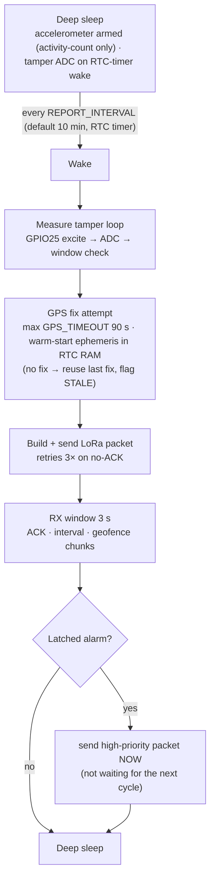
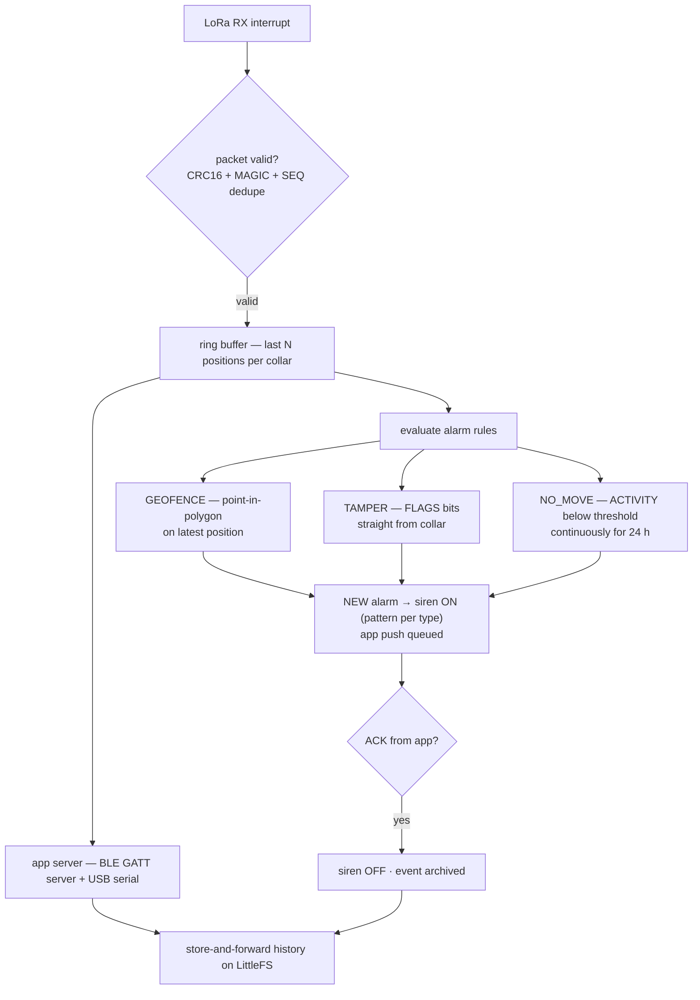

# Firmware — Collar & Base Station

Arduino-IDE C++ (Arduino-ESP32 core) for both collar and base station. One repo, two sketches:

```
firmware/
├── collar/        ← LilyGO T-Beam v2.x
└── basestation/   ← ESP32 DevKit + Ra-02 (SX1278)
```

---

## Collar Firmware

### Main state machine



Key configuration (stored in NVS, editable over-the-air from app via base station):

| Param | Default | Meaning |
|---|---|---|
| `REPORT_INTERVAL` | 10 min | Position packet period |
| `GPS_TIMEOUT` | 90 s | Max fix wait per cycle |
| `GEOFENCE` | from app | Polygon (max 16 vertices) evaluated on-collar for early warning |
| `NO_MOVE_HOURS` | 24 h | Immobility rule window |
| `COLLAR_ID` | per unit | Stable short ID used in packets |
| `LOOP_R0` | per unit | Recorded intact loop baseline (Ω) at commissioning — tamper bands are relative to it |
| `RX_WINDOW_MS` | 3000 | Post-TX downlink listen window (see MAC & Downlink Protocol) |

### Power-critical implementation notes

1. **Deep sleep current is the project's #1 silent killer.** A naive T-Beam deep sleep drains in days. In `esp_sleep` setup, disable: LoRa (SX1278 sleep opmode), GPS power rail (AXP2101 GPS rail off), and unused AXP rails. Measure with a µA meter — target < 2 mA whole-system sleep, ideally < 500 µA. See [POWER.md](POWER.md).
2. **Motion-gated GPS, motion never wakes the radio:** motion interrupts only increment the activity counter (the collar does *not* run a GPS/TX cycle on motion — that would blow the power budget; see [POWER.md](POWER.md)). At the scheduled cycle, if the counter hasn't moved since the last fix, skip GPS — resend last position with `moved=false`. Saves up to 80% of energy.
3. **Tamper excitation only during measurement** (GPIO25 drive) — no constant current through the loop (also prevents electrolytic corrosion of the rope).
4. **Ephemeris warm start:** with RTC RAM retained across deep sleep, warm fixes take 5–15 s instead of 30–60 s — the single biggest energy lever after duty cycling.
5. **Latched alarms:** a *confirmed* tamper event (`LOOP_OPEN` / `LOOP_BUCKLE` / `LOOP_SHORT` — steady out-of-window reading, debounced) latches a flag; the next wake sends the alarm immediately, then keeps sending at 1-min intervals until ACKed by base. (Keep-alive: a collar under attack must not go quiet.) A *brief* out-of-band glitch that re-closes within the debounce window latches `LOOP_SUSPECT` instead — a telemetry warning, never a siren trigger (strap-flex false-alarm guard; see [TAMPER.md](TAMPER.md)). Alarm bands are **relative to the collar's recorded baseline R₀** (R₀ ± 30% OK · R₀ + 220 Ω buckle · < 40 Ω short · > 2 kΩ open) — set at commissioning, stored in NVS.

### Libraries

| Library | Use |
|---|---|
| `RadioLib` | SX127x LoRa — `SX1278` class for the 433 MHz variant (better power control than LoRa.h) |
| `TinyGPSPlus` | NEO-M8N NMEA parsing |
| `Adafruit_MPU6050` | Accelerometer + motion-detect interrupt (MOT_THR / MOT_DUR, accel-only cycle mode — ISR counts activity only, never a radio wake) |
| `AXP2101` (LilyGO / x-lqi) | PMU rail management on T-Beam v2.x |
| `ArduinoJson` | Packet serialization + app/base config messages |

## LoRa Radio Settings

| Parameter | Value |
|---|---|
| Frequency | 433 MHz (or 915 — **must match base station**; PH allocations: prefer 433 MHz ISM band for this use) |
| Spreading factor | SF7–SF9 (SF7 fast/short range; SF9 for far paddocks — configurable per site) |
| Bandwidth | 125 kHz |
| Coding rate | 4/5 |
| Sync word | private 0x2B (not LoRaWAN — raw point-to-multipoint) |
| Preamble | 8 |

> Raw LoRa, not LoRaWAN: no gateway/network-server infrastructure exists offline, and we control both ends. Simple ACK/retry protocol below.

## Packet Format (binary, 23 bytes max body)

```
Byte  Field        Meaning
0     MAGIC        0x5C
1     COLLAR_ID    uint8 (stable per collar)
2     FLAGS        bit0 GEOFENCE_OUT (on-collar pre-check)
                    bit1 TAMPER (latched)
                    bit2 TAMPER_BUCKLE (buckle-open subtype)
                    bit3 TAMPER_SHORT (bypass subtype)
                    bit4 NO_MOVE_24H
                    bit5 LOW_BATT
                    bit6 STALE_FIX (reused position)
                    bit7 EMERGENCY (send now, ACK required)
3     BAT_PERCENT  uint8 (0–100)
4-7   LAT          int32  (1e-6 deg, signed)
8-11  LON          int32  (1e-6 deg)
12    ACTIVITY     uint8 (0–255, rolling motion score)
13    LOOP_R       uint8 (tamper loop resistance / 8, 0–2040 Ω)
14    SEQ          uint8 (packet sequence, wrap)
15-16 CRC16        uint16 LE (CCITT-FALSE: poly 0x1021, init 0xFFFF, over bytes 0–14)
17    DL_ACK_SEQ   uint8 (SEQ of last accepted downlink frame; 0xFF = none yet)
```

Fixed fields total **18 bytes** — the ≤ 23-byte body budget leaves 5 bytes headroom for future telemetry (e.g., collar temperature). `LOOP_SUSPECT` warnings surface via the `LOOP_R` reading (no dedicated flag bit). The base **drops any uplink whose CRC16 mismatches** — at SF9 fringe, bit errors are routine, and no rule may ever evaluate on a corrupt packet.

Base → collar downlink: full spec in **MAC & Downlink Protocol** below.

### MAC & Downlink Protocol

**Uplink cadence**

- One base station is the sink; collars transmit on their interval with **randomized ±5% jitter** to avoid collisions (battery-drain-herd-sync is a classic failure).
- Emergency packets retry up to 3× at 30 s spacing until base ACKs — the ACK is a downlink `ACK` frame echoing the emergency packet's `SEQ`.
- Base sends a broadcast timeslot sync once daily; collars align wake windows for geofence push-down.

**Downlink frame** (base → collar; not bound by the 23-byte uplink rule, but keep ≤ 222 B — the LoRa max payload at SF7 / 125 kHz):

```
Byte   Field        Meaning
0      MAGIC_DL     0x5D
1      TARGET_ID    collar ID (0xFF = broadcast)
2      TYPE         0x01 GEOFENCE · 0x02 INTERVAL · 0x03 ACK · 0x04 CLEAR_LATCH · 0x05 SYNC
3      SEQ          uint8 (downlink sequence, wraps — echoed by the collar in DL_ACK_SEQ)
4      LEN          payload length (0–200)
5..    PAYLOAD      type-specific (below)
last2  CRC16        CCITT-FALSE over bytes 0..end-2
```

| TYPE | Payload | Behavior at the collar |
|---|---|---|
| `GEOFENCE` | chunked polygon: `chunk_idx (1 B) · chunk_cnt (1 B) · poly_crc16 (2 B) · ≤ 196 B of (lat i32, lon i32) vertex pairs` | Buffer chunks; verify `poly_crc16` + vertex count ≤ 16 **before** swapping the active polygon. Staged commit: a corrupt or partial push never leaves the collar without a fence — the old polygon is kept on any failure |
| `INTERVAL` | `report_interval_s` (uint16) | Applies immediately; saved to NVS |
| `ACK` | `uplink_seq` (uint8) | Stops the emergency 1-min repeat ladder for that SEQ |
| `CLEAR_LATCH` | empty | Clears a latched tamper flag **only if service mode was entered within the last 10 min** (hall sensor); otherwise ignored and logged |
| `SYNC` | `unix_time (4 B) · next_sync_s (2 B)` | Daily broadcast; collars align wake windows |

**RX windows (when the collar listens):**

- After **every uplink**, the collar opens an RX window for `RX_WINDOW_MS = 3000` ms (+ 100 ms stagger per collar ID so multi-collar ACKs don't collide). This is the only downlink path for `ACK`, `INTERVAL`, and geofence chunks.
- After the **daily SYNC broadcast**, collars hold a second 10 s window for the first `GEOFENCE` chunk.
- Energy cost: the MCU + radio stay active (~90 mA) for 3 s → **+0.45 mA average** at the 10-min interval — accounted in [POWER.md](POWER.md). Shortening to 1 s cuts it to +0.15 mA if bench tests prove the base always answers within 1 s.
- ARQ: the base re-sends an unacknowledged downlink at the next opportunity (up to 3 tries), matching on the collar's `DL_ACK_SEQ` echo.

**Geofence sizing note:** 16 vertices × 8 B = 128 B payload → a single chunk at SF7; at SF9 (max ~120 B) it fragments into 2 chunks automatically — the chunk scheme is SF-proof.

**Base clock:** no RTC hardware — the base keeps wall-clock time set from the farmer's phone: the app sends `TIME_SET {epoch}` over BLE on every connect (phone time is NTP-accurate). No alarm rule depends on wall-clock time — geofence, tamper, no-move, and silence all run on packet arrival / monotonic time; wall time is for history and CSV export only. After a reboot with the phone away, the clock is `unsynced` and history rows are flagged until the next connect. Collars stay clockless — timestamps are base-side only.

## Base Station Firmware



- **Siren:** relay-driven 12 V siren (1-ch relay, IN1 on **GPIO17** of the base ESP32 — GPIO23 stays reserved for the Ra-02 SPI MOSI; see [WIRING.md](WIRING.md)); distinct patterns: geofence = 3 short/2 min pause repeat; tamper = continuous; no-movement = long 10 s every 5 min. Auto re-arm. **Gated off while maintenance mode is set.**
- **History:** LittleFS CSV/JSON per collar (position, flags, loop R, batt) — months of data at 10-min intervals is small (~100 KB/collar/month).
- **Wall clock:** software — `TIME_SET {epoch}` from the app over BLE on connect (see [BASE-STATION.md](BASE-STATION.md)); `unsynced` flag after an offline reboot. Collars send no time and need none.
- **Maintenance mode:** the rules engine honors a `maintenance` flag (BLE `MAINT_ON {minutes}` / `MAINT_OFF` from the app; default 30 min, max 2 h, auto-expires). While set, geofence/tamper/no-move events are **logged as `suppressed`** but never fire the siren; low-battery and collar-silence alerts still pass; every ON/OFF/expiry is timestamped (see [BASE-STATION.md](BASE-STATION.md)).
- **Watchdog:** ESP32 task watchdog on both LoRa RX and app server loops; base station is unattended hardware, it must self-heal.

## Flashing & Config

1. Arduino IDE → board "ESP32 Dev Module" (T-Beam), 921600 upload; USB-C on v2.x powers and flashes directly.
2. First boot creates NVS config with defaults; set `COLLAR_ID` via serial CLI (`id 7`) or app.
3. Serial console at 115200 — keep it attached for the first week of field testing (log everything).
4. OTA over the app link is a stretch goal — bench flash until it's proven in the field.

## Bench Acceptance (pre-deploy gate)

- [ ] 48 h continuous run, zero missed expected packets at 10 m range
- [ ] Deep-sleep current within budget (see [POWER.md](POWER.md))
- [ ] All three alarm types produce correct siren patterns on the base
- [ ] Geofence push-down reaches collar within 24 h window
- [ ] SEQ dedupe works (inject replayed packets — no duplicate alarms)
- [ ] CRC: flip one byte in a test packet → base drops it, no rule fires
- [ ] Downlink: geofence push lands inside the RX window (test 1-chunk and 2-chunk paths); corrupt-chunk test keeps the old polygon; `CLEAR_LATCH` outside service mode is ignored and logged
