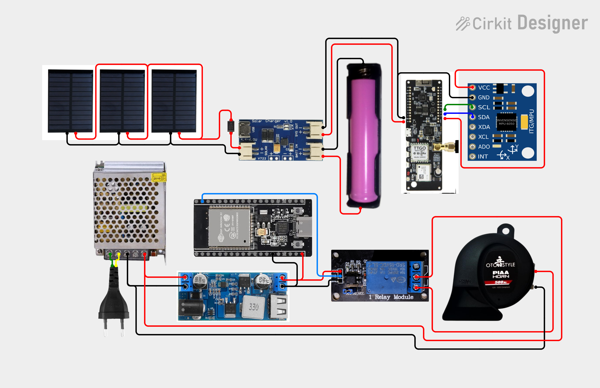

# Wiring — Circuit Diagram & Netlist

The complete electrical design lives in one diagram, built in Cirkit Designer:

| Source | What it is |
|---|---|
|  | Full wiring diagram — collar circuit (solar chain + tamper loop) and base-station circuit (power + siren) |
| [`wiring/SmartCollar.ckt`](../wiring/SmartCollar.ckt) | Editable Cirkit Designer project |
| [Cirkit Designer — SmartCollar project](https://app.cirkitdesigner.com/project/fdca6758-069a-49d6-b99e-c560568bd131) | Online source of truth (open, then edit/export) |

The netlist below is extracted programmatically from the `.ckt` project file — it is the authoritative connection list. Two sub-circuits share the sheet: **Collar** (one of three identical collars) and **Base Station** (single unit).

## 1. Collar sub-circuit

Components: ESP32 DevKit 38-pin, NEO-M8N GPS breakout, Ai-Thinker Ra-02 (SX1276, 915 MHz), MPU6050, stainless wire rope + series resistors (tamper loop), TP4056 charge module, AP2112 LDO, 18650 cell in holder, 3× 5 V solar panels (Phase 2), 3× SS14 Schottky diodes, CN3065 solar charge controller.

### Power distribution

| Rail | Source | Feeds | Notes |
|---|---|---|---|
| Battery (+) | 18650 cell (3.0–4.2 V) | Collar electronics via AP2112 LDO; solar chain input | Main power rail |
| 3.3 V | AP2112 SMD LDO (from battery+) | ESP32, sensors, LoRa, GPS | Low-quiescent regulator; add 10 µF + 100 nF decoupling |
| GPS rail | GPIO13-gated N-FET (SI2301) | NEO-M8N VCC | Shuts off in deep sleep |
| LoRa rail | GPIO15-gated N-FET (SI2301) | Ra-02 VCC (via 100 µF + 100 nF) | Shuts off in deep sleep |
| Solar bus (+) | 3 × 5 V 0.3 W panels (parallel) → SS14 diodes | CN3065 solar input | Per-panel blocking diodes prevent back-feed |
| CN3065 Batt Out | Cell + terminal | 18650 positive tab | Parallel with main cell connection |

### GPS Module — NEO-M8N (UART2)

| From | To | Purpose |
|---|---|---|
| NEO-M8N TX | GPIO16 (UART2_RX) | NMEA stream to ESP32 |
| NEO-M8N RX | GPIO17 (UART2_TX) via 1 kΩ | Commands from ESP32 (bi-directional level shift) |
| NEO-M8N VCC | 3.3 V | Module power (verify LDO dropout at low cell voltage) |
| NEO-M8N GND | GND | Common ground |

### LoRa Module — Ra-02 (SX1276, 915 MHz) via VSPI

| Ra-02 pin | ESP32 38-pin | Purpose |
|---|---|---|
| VCC | 3.3 V | 3.3 V **only** — 5 V destroys the SX1276 |
| GND | GND | Common ground |
| SCK | GPIO18 | VSPI SCK |
| MISO | GPIO19 | VSPI MISO |
| MOSI | GPIO23 | VSPI MOSI |
| NSS (CS) | GPIO5 | VSPI chip select |
| RST | GPIO14 | RadioLib reset |
| DIO0 | GPIO26 | TX/RX-done interrupt (RadioLib IRQ) |

> **Notes:** add 100 µF + 100 nF decoupling at the Ra-02 VCC (TX bursts ~120 mA brown out weak 3.3 V rails). Never transmit without the antenna attached. GPIO23 stays reserved for SPI MOSI.

### Sensors / I²C

| From | To | Purpose |
|---|---|---|
| MPU6050 (SDA) | ESP32 (GPIO21 / SDA) | I²C data |
| MPU6050 (SCL) | ESP32 (GPIO22 / SCL) | I²C clock |
| MPU6050 (VCC) | ESP32 (3.3V) | Sensor supply |
| MPU6050 (GND) | ESP32 (GND) | Common ground |
| MPU6050 (ADO, XDA, XCL, INT) | — (unconnected) | INT not used — the motion flag is polled over I²C each wake cycle (see [POWER.md](POWER.md)); tie ADO to GND for address 0x68 on the real build |

### Tamper loop (as drawn — simplified)

The netlist shows the rope loop wired as: ESP32 GPIO25 → series resistor → rope end A → rope through the full strap → rope end B → GND rail. **This is a simplified stand-in.** Build the circuit documented in [TAMPER.md](TAMPER.md) / [HARDWARE.md](HARDWARE.md): `GPIO25 → 10 kΩ → sense node`, rope end A → strap (break-away link at the buckle) → rope end B → **100 Ω far end** → GND, with the **GPIO36 ADC** tapping the sense node to read the divider — the single-resistor drawing cannot distinguish a bypass from an intact loop. (In the diagram, GPIO36 is routed through an available ADC pin — intentional. The drawing still needs updating to the two-resistor circuit, so follow this section and TAMPER.md over the diagram for the loop.)

## 2. Base-station sub-circuit

Components: AC plug, 12 V 5 A switching PSU (S-60-12), 12 V → 5 V buck (Circuitrocks 36V→5V 5A), ESP32 DevKit 38-pin, 1-ch relay, 12 V siren ("pia horn" in the diagram).

| From | To | Purpose |
|---|---|---|
| AC plug (Line) | PSU (220 V + / AC L) | Mains input |
| AC plug (Neutral) | PSU (220 V − / AC N) | Mains input |
| PSU (12 V DC +) | Net 12 (+12 V rail) | Main 12 V rail |
| PSU (GND / DC −) | Net 11 (GND rail) | Main ground |
| Net 12 (+12 V rail) | Relay (COM) | Switched feed for the siren |
| Net 12 (+12 V rail) | Buck (VIN+) | Buck input |
| Net 11 (GND rail) | Buck (VIN−) | Buck return |
| Buck (5V out) | ESP32 (VIN 5V) | Logic supply |
| Buck (GND out) | ESP32 (GND) | Common ground |
| ESP32 (GPIO17) | Relay (IN1) | Siren drive — patterned per alarm type (see [FIRMWARE.md](FIRMWARE.md)) |
| ESP32 (GND) | Relay (GND) | Relay logic ground |
| Relay (NO) | Siren (+) | Siren energizes when GPIO17 drives the relay |
| Siren (−) | Net 11 (GND rail) | Siren return |

**Connection summary:** AC → PSU (12 V 5 A) → two branches: (a) 12 V → relay COM → siren (NO), (b) 12 V → buck → 5 V → ESP32. GPIO17 → relay IN1 switches the siren. NC contact unused (siren off by default).

### Base LoRa receiver — SX1276 (Ra-02) → ESP32 DevKit (as drawn in the diagram)

| Ra-02 pin | ESP32 38-pin | Purpose |
|---|---|---|
| VCC | 3V3 | 3.3 V **only** — 5 V destroys the SX1276 |
| GND | GND | Common ground |
| SCK | GPIO18 | VSPI SCK |
| MISO | GPIO19 | VSPI MISO |
| MOSI | GPIO23 | VSPI MOSI |
| NSS (CS) | GPIO5 | VSPI chip select |
| RST | GPIO14 | RadioLib reset |
| DIO0 | GPIO26 | TX/RX-done interrupt (RadioLib IRQ) |

> **Notes:** add 100 µF + 100 nF decoupling at the Ra-02 VCC (TX bursts ~120 mA brown out weak 3.3 V rails). Never transmit without the antenna attached. GPIO23 stays reserved for SPI MOSI — this is why the siren relay moved from GPIO23 to **GPIO17** (GPIO16/17 are free on the 38-pin WROOM board; GPIO17 is UART2-TX by default, unused here).

## 3. Deltas vs. the reference design (HARDWARE.md / BASE-STATION.md)

| Point | Diagram | Reference design | Why it differs / what to do |
|---|---|---|---|
| PMU | Not used (replaced by AP2112 LDO + GPIO-gated FETs) | No AXP2101 — discrete build uses manual rail control | See [HARDWARE.md](HARDWARE.md) § Power Architecture and [POWER.md](POWER.md) |
| DS3231 RTC | Not used (decided) | No RTC hardware — phone sets the base clock via BLE `TIME_SET` on connect | Nothing to wire; see [BASE-STATION.md](BASE-STATION.md) |
| Tamper loop | Drawn simplified — one series resistor, no GPIO25/GPIO36 junction | GPIO25 → 10 kΩ → node (GPIO36 taps) → rope → 100 Ω far end → GND | Build the reference circuit from [TAMPER.md](TAMPER.md) / [HARDWARE.md](HARDWARE.md); tidy the diagram on the next edit |
| Relay board | IN1 driven directly | Opto-isolated boards also have a JD-VCC jumper | Keep jumper closed for 5 V logic drive; see BOM relay note |
| MPU6050 | GY-521 module | Strip power LED + LDO for sleep budget | Do the LED/LDO strip per [POWER.md](POWER.md) when building |
| Solar chain | Present | Phase-2 upgrade | Build it now on the Phase-1 collar or leave panels off — the wiring is identical |

## 4. Power rails at a glance

| Rail | Source | Feeds | Budget |
|---|---|---|---|
| 12 V | S-60-12 PSU (mains) | Siren (via relay), buck input | 5 A — siren draws > 1 A when sounding ([BASE-STATION.md](BASE-STATION.md)) |
| 5 V | Circuitrocks buck (12 V → 5 V) | ESP32 DevKit VIN, relay module VCC | 5 A module, < 1 A actual |
| 3.3 V | AP2112 LDO (battery+) | ESP32, sensors, radios | Per-module; total < 500 mA peak |
| GPS rail | GPIO13-gated FET from 3.3 V | NEO-M8N | ~90 mA active, 0 µA in sleep |
| LoRa rail | GPIO15-gated FET from 3.3 V | Ra-02 | ~120 mA TX, ~10 mA RX, 0 µA in sleep |
| Battery | 18650 (3.0–4.2 V) via TP4056 / CN3065 | Collar ESP32 | 3,500 mAh — duty-cycled per [POWER.md](POWER.md) |
| Solar | 3× 5 V 0.3 W panels → SS14 → CN3065 | 18650 trickle charge | ~0.9 W STC array |

## 5. Build-order notes

1. Wire the **base** first: it is bench-testable immediately (power up, flash, `B2` LoRa link once the Ra-02 is added).
2. Wire the **collar** power chain (18650 + ESP32 + AP2112) before the solar chain; validate sleep current with panels disconnected.
3. Add the solar chain last — it must not change the sleep budget (verify sleep current again with panels connected).
4. Commons: every sub-circuit shares its own GND — collar GND is floating (never tied to base), base GND is PSU-referenced.